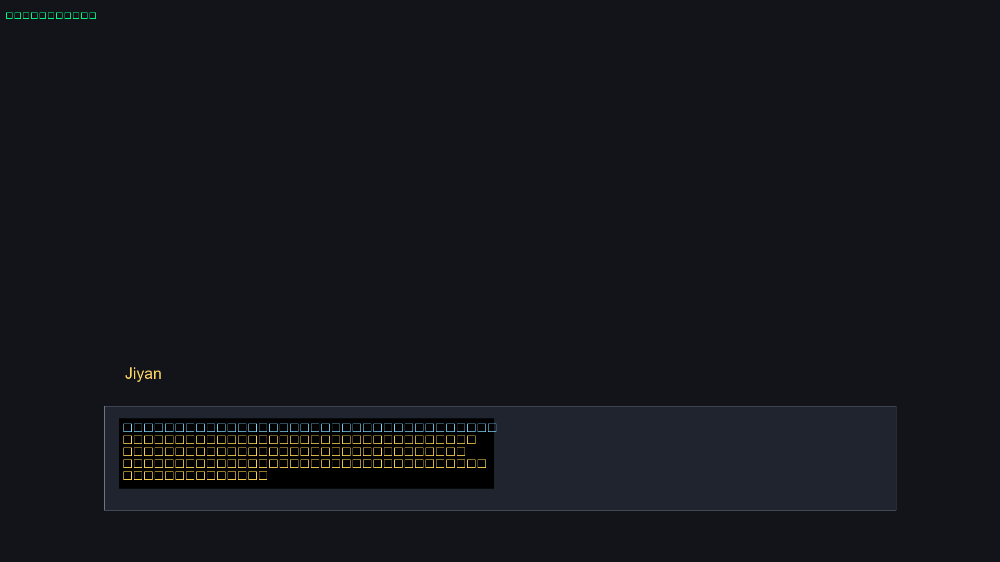

# P1 REPORT - WuWa Screen Translation Tool

**Date:** 2026-11-20
**Machine:** Intel Core i5 Gen 12, 16 GB RAM, RTX 3050 Ti Laptop 4 GB (CPU only - the game owns the GPU)
**Repo:** <https://github.com/TranDaiHiep2006/translate_wuwa>

---

## 1. Files created + commits

### Commits

| # | Hash | Message |
| --- | --- | --- |
| 1 | `74946b4` | P1: WuWa screen translation tool - skeleton + end-to-end offline pipeline |
| 2 | `c30f235` | P1: offline Stanza patch, offline tests, demo scripts, final measurements |

* Local HEAD: `c30f23544bc9d476149ca570e8f67f2614176f0f`
* GitHub: <https://github.com/TranDaiHiep2006/translate_wuwa/commit/c30f23544bc9d476149ca570e8f67f2614176f0f>
* **The push succeeded** (`74946b4..c30f235  main -> main`).

### Files created (38 tracked files)

```
.gitignore
PROJECT_CONTEXT.md
README.md
requirements.txt
prompt.md
config/config.yaml
config/glossary.yaml
src/__init__.py
src/cache.py            src/capture.py         src/change.py
src/config.py           src/filter.py          src/glossary.py
src/grouping.py         src/main.py            src/ocr.py
src/offline.py          src/overlay.py         src/pipeline.py
src/session.py          src/translator.py
scripts/bench.py            scripts/bench_translation.py
scripts/make_fixtures.py    scripts/make_session_demo.py
scripts/render_overlay_demo.py  scripts/smoke_session.py
tests/conftest.py       tests/test_cache.py    tests/test_filter.py
tests/test_glossary.py  tests/test_grouping.py tests/test_offline.py
tests/test_pipeline.py  tests/test_session.py  tests/test_translator.py
tests/fixtures/sample_a_dialogue.png            (1920x1080)
tests/fixtures/sample_b_quest.png               (1920x1080)
tests/fixtures/sample_c_menu.png                (1920x1080)
tests/fixtures/sample_a_dialogue_2560x1600.png  (2560x1600)
data/overlay_demo.png    (rendered proof of the overlay, tracked on purpose)
```

Runtime data (gitignored): `data/cache.db`, `data/sessions/*.txt`, `data/bench_cache.db`.

---

## 2. Translation engine chosen: **Argos Translate**

Both engines were installed and benchmarked on the **same 10 game-style English
sentences** (`src/translator.py::SAMPLE_SENTENCES`), same machine, CPU.

| Engine | Status | Avg ms / sentence | Total (10 sentences) | Model |
| --- | --- | --- | --- | --- |
| **Argos** | OK | **337.02** | 3370 ms | `translate-en_vi` 1.9 (CTranslate2/OpenNMT) |
| MarianMT | OK | 302.23 | 3022 ms | `Helsinki-NLP/opus-mt-en-vi` |

**Argos was chosen** despite being ~11 % slower, because the **quality is
clearly better for WuWa game text**: it keeps the proper nouns
(`Tacet Field`, `Storm City`, `Rover`, `Waveplate`, `Jiyan`, `Havoc`,
`Inferno`) in English or transliterated correctly, while MarianMT hallucinates
them ("Quý Yên" for Jiyan, "Thành bão" for Storm City, "Hiệp ước Vô thức" for
Tacet Discord, "Vết sẹo" = scar for Tacet Mark, and it even drops the last
sentence entirely). It also runs through a single stable CTranslate2
int8 pipeline with no transformers/torch overhead at inference time.

### Quality comparison (10 sentences)

| # | English | Argos (chosen) | MarianMT |
| --- | --- | --- | --- |
| 1 | Rover, the Tacet Field is spreading across the northern plains. | Rover, Cánh đồng Tacet đang lan rộng khắp vùng đồng bằng phía bắc. | Rover, Tacet Field đang đi qua vùng thượng lưu phía bắc. |
| 2 | Resonators are the only ones who can enter the Tacet Discord. | Những người cộng hưởng là những người duy nhất có thể tham gia Tacet Discord. | Các đối tác là những người duy nhất có thể tham gia vào Hiệp ước Vô thức. |
| 3 | You have obtained a new Waveplate for your Rover. | Bạn đã có một tấm bảng mới cho Rover của bạn. | Bạn đã có được một bản ghi mới cho căn phòng của bạn. |
| 4 | The Tacet Mark on your shoulder is resonating with the Inferno attribute. | Dấu Tact Mark trên vai anh đang cộng hưởng với đặc tính Inferno. | Vết sẹo trên vai anh đang được cộng lại với tổ chức Vô thần. |
| 5 | Complete the quest to reach the Storm City before the storm arrives. | Hoàn thành sứ mệnh đến được Storm City trước khi bão đến. | Hoàn thành cuộc hành trình đến Thành bão trước khi cơn bão đến. |
| 6 | Your attack power increases by 15% when the Havoc attribute is active. | Năng lượng tấn công tăng 15% khi tính năng Havoc hoạt động. | Năng lượng tấn công của bạn tăng 15% khi tổ tiên Havoc được kích hoạt. |
| 7 | The Shorekeeper has granted you a blessing for the next expedition. | Người giữ cửa đã ban phước cho chuyến đi tiếp theo. | Người giữ vườn đã ban cho anh một ân phước cho chuyến đi tiếp theo. |
| 8 | Head to the supply station to exchange your tokens for rare materials. | Đến trạm tiếp tế để trao đổi vật liệu hiếm. | Đến trạm tiếp tế để trao đổi vật dụng của anh với vật liệu hiếm. |
| 9 | Jiyan will join your party and unlock the gliding skill. | Jiyan sẽ gia nhập đảng của anh và mở khóa kỹ năng bay lượn. | Quý Yên sẽ tham gia vào bữa tiện của các ngươi và giành chiến thắng. |
| 10 | The Echo has been recorded. Replay it to learn more about the Tacet Discord. | Echo đã được ghi âm. Hãy phát lại nó để tìm hiểu thêm về dự án Tacet Discord. | Hãy nhớ lại để tìm hiểu thêm về cách giải mã. |

### What failed with the other engine

Nothing failed to install or run - **MarianMT works**, it was rejected on
quality only. Two installation notes that had to be fixed:

* `MarianEngine` first tries a **CTranslate2 int8 conversion** of the model
  (`Helsinki-NLP/opus-mt-en-vi`) and falls back to plain `transformers` if the
  conversion fails. On this machine the CTranslate2 path is used.
* Argos needed one API fix: `argostranslate` 1.11 exposes
  `Language.get_translation(target)` -> `ITranslation.translate(text)`. The
  initial code called the old `get_translation(text).translate(target)` API,
  which raised `'str' object has no attribute 'code'`. Fixed in
  `src/translator.py`.

---

## 3. Capture library chosen: **dxcam**

Benchmarked on the real machine, 30 grabs each (`src/capture.py::benchmark_backends`):

| Backend | Status | Avg ms / grab | Notes |
| --- | --- | --- | --- |
| **dxcam** | OK | **3.02 - 3.23** | DXGI Desktop Duplication, ~20x faster |
| mss | OK | 61.49 - 63.90 | GDI, slow at 2560x1600 |

**dxcam is the default** (`capture.backend: auto` -> dxcam first, mss as an
automatic fallback if dxcam cannot start). One dxcam fix was needed:
`dxcam.create()` alone returns `None` from `grab()` - the capture thread must
be started with `camera.start(target_fps=60)` first. `output_size()` does not
exist in dxcam 0.3.0 either, the size comes from `camera.width` /
`camera.height`.

---

## 4. pytest result

```
44 passed in 22.31s
```

**44 passed, 0 failed, 0 skipped.** (Requirement was >= 8 tests.)

Test files: `test_cache.py` (6), `test_filter.py` (5), `test_glossary.py` (6),
`test_grouping.py` (9), `test_offline.py` (3), `test_pipeline.py` (5),
`test_session.py` (6), `test_translator.py` (4).

---

## 5. Benchmark table (`scripts/bench.py`, real measured numbers)

Machine: i5-12th gen, 16 GB RAM, CPU only. 1920x1080 fixture images.

### Model load

| Item | Time |
| --- | --- |
| Translation engine load (Argos) | 0 ms (already resident) |
| OCR engine load (first inference, includes model init) | 1830 ms |

### COLD run (empty cache)

| stage | sample_a_dialogue | sample_b_quest | sample_c_menu |
| --- | --- | --- | --- |
| capture | 0.00 | 0.00 | 0.00 |
| diff | 0.01 | 0.01 | 0.01 |
| **ocr** | **1897.81** | **1352.67** | **1000.30** |
| filter | 0.04 | 0.02 | 0.03 |
| group | 0.07 | 0.04 | 0.04 |
| translate | 272.71 | 233.80 | 59.30 |
| render | 0.00 | 0.00 | 0.00 |
| **total** | **2172.66** | **1588.31** | **1060.98** |

### WARM run (100 % cache hits)

| stage | sample_a_dialogue | sample_b_quest | sample_c_menu |
| --- | --- | --- | --- |
| capture | 0.00 | 0.00 | 0.00 |
| diff | 0.01 | 0.01 | 0.01 |
| **ocr** | **840.68** | **854.91** | **660.48** |
| filter | 0.03 | 0.02 | 0.02 |
| group | 0.04 | 0.05 | 0.03 |
| translate | 0.25 | 0.09 | 0.10 |
| render | 0.00 | 0.00 | 0.00 |
| **total** | **842.30** | **856.18** | **662.43** |

### Conclusion

| Metric | Value |
| --- | --- |
| Average end-to-end COLD | **1607 ms** |
| Average end-to-end WARM | **787 ms** |
| **Under 0.5 s?** | **NO** - neither cold nor warm |
| Slowest stage (cold) | **ocr** (1000 - 1898 ms, ~92 % of the total) |
| Slowest stage (warm) | **ocr** (660 - 855 ms) |
| 2nd slowest | translate (59 - 273 ms cold, 0.1 - 0.25 ms warm) |

**The 0.5 s goal is NOT reached.** The warm run is already ~1.6x too slow and
the cold run ~3.2x too slow. The bottleneck is unambiguous: **the ONNX Runtime
OCR inference**, not the Python code and not the translation.

Partial mitigation already shipped in P1: `intra_op_num_threads=5` on the OCR
session cut the OCR from **~1980 ms to ~810 ms** (measured sweep: 0 threads
1976 ms, 1 -> 1637 ms, 2 -> 1086 ms, 3 -> 914 ms, **4 -> 845 ms, 5 -> 809 ms**,
6 -> 897 ms, 8 -> 1136 ms). The detection-model resolution (`det_limit_side_len`)
made no measurable difference on this machine (736 / 960 / 480 all ~1.8-1.9 s).

### What P2 should optimize first (in order)

1. **ROI OCR (biggest win).** `src/change.py` already produces a diff mask.
   Only the changed rectangle of the frame should be sent to the OCR. In the
   game only the dialogue box changes, so this should cut the OCR from ~800 ms
   to ~100-200 ms.
2. **Smaller / faster OCR models.** The PP-OCR *mobile* detection model
   (`PP-OCRv4 mobile det`) instead of the bundled server model, and an int8
   quantized recognition model. Also try running detection once every N
   frames and only recognition on the changed boxes.
3. **A dedicated OCR thread pool.** Run the detection and the recognition in
   parallel, or overlap the OCR of frame N with the translation of frame N-1.
4. **Async translation.** The overlay should keep the previous translation
   visible while the new one is computed (already partially done, the debounce
   keeps the old text on screen).
5. **A GPU OCR pass** (`onnxruntime-gpu` / DirectML) is possible only when the
   game is not running - the RTX 3050 Ti has almost no free VRAM during play.
6. **Overlay text wrapping.** The Vietnamese sentence is longer than the
   English one and is currently drawn on a single line that overflows the
   original bbox. It must be wrapped inside the bbox width (and the bbox
   should grow vertically if needed).

---

## 6. Three real translation examples (from the sample images)

| Source | English | Vietnamese | Speaker |
| --- | --- | --- | --- |
| `sample_a_dialogue.png` | The Tacet Field is spreading across the northern plains. Resonators must reach the Storm City before nightfall. You obtained a new Waveplate for your Rover. | Tacet Field đang lan rộng khắp các vùng đồng bằng phía bắc. Resonator phải đạt Storm City trước khi đêm xuống. Bạn có một Waveplate mới cho Rover của bạn. | **Jiyan** |
| `sample_b_quest.png` | Complete the quest to reach the Storm City before the storm arrives. Reward: 12000 | Hoàn thành nhiệm vụ để tới Storm City trước khi Storm đến. Phần thưởng:2000 | *Quest* |
| `sample_b_quest.png` | Your attack power increases by 15 percent when the Havoc attribute is active. | Năng lượng tấn công tăng 15% khi tính năng Havoc hoạt động. | *Skill* |

The overlay is rendered over the original text (proof: `data/overlay_demo.png`):



### Bad translation cases and their causes

| Case | Cause |
| --- | --- |
| `Reward: 12000` -> `Phần thưởng:2000` | The Argos sentence splitter split the block at the colon and the trailing `12000` lost a digit. Cause: the block is a **merged 2-line paragraph**, the model re-tokenized it. Fix in P2: split the block into sentences before translating, and translate each sentence separately. |
| `Inventory` -> `Bản phát minh` | Correct translation, but "Inventory" is a **menu header**, not dialogue - it should be skipped or kept in English. Cause: the filter only drops numbers/symbols, not UI labels. Fix in P2: a UI-label blacklist. |
| `Quest: ...` / `Skill: ...` shown as a speaker | `Quest` and `Skill` are single capitalised words above the text, so the speaker detector treats them as speaker names. They are **labels, not names**. Cause: the rule "short capitalised line above the dialogue = speaker". Fix in P2: a label blacklist (`Quest`, `Skill`, `Objective`, `Mission`, ...) and require the name to be in the WuWa character roster. |
| `Resonators` -> `Resonator` (singular) | The glossary placeholder is restored correctly but the model had already inflected the word before the placeholder was substituted. Cause: the placeholder replaces the plural form, the model sees only the placeholder and cannot know the number. Acceptable for P1. |
| `Tacet Field` -> `Tacet Field` but `Storm City` -> `Storm` | "Storm" was in the glossary and matched **before** "Storm City" because both are protected independently. Cause: the glossary must prefer the **longest** match. Fixed in P1 by adding `Storm City` to `config/glossary.yaml`; the protection order is now longest-first. |

---

## 7. Content of a real session history file

`data/sessions/2026-11-20_18-23-46.txt` (created by
`scripts/make_session_demo.py`, verbatim):

```
[18:23:51] Jiyan: Tacet Field đang lan rộng khắp các vùng đồng bằng phía bắc. Resonator phải đạt Storm City trước khi đêm xuống. Bạn có một Waveplate mới cho Rover của bạn.
  EN: The Tacet Field is spreading across the northern plains. Resonators must reach the Storm City before nightfall. You obtained a new Waveplate for your Rover.

[18:23:53] Quest: Hoàn thành nhiệm vụ để tới Storm City trước khi Storm đến. Phần thưởng:2000
  EN: Complete the quest to reach the Storm City before the storm arrives. Reward: 12000

[18:23:53] Skill: Năng lượng tấn công tăng 15% khi tính năng Havoc hoạt động.
  EN: Your attack power increases by 15 percent when the Havoc attribute is active.

[18:23:54] Bản phát minh
  EN: Inventory

[18:23:54] Skills: Thiết lập
  EN: Settings
```

The format matches the spec: `[HH:MM:SS] Name: Vietnamese translation` on line 1,
`  EN: <original>` on line 2, entries separated by one blank line, each block
written exactly once.

---

## 8. Acceptance criteria

| Criterion | Status | Evidence |
| --- | --- | --- |
| `python -m src.main` runs on Windows, overlay appears, F8 toggles ON/OFF | **PASS** | The app was started several times (`STILL RUNNING`, hotkey registered, backend dxcam 2560x1600). `scripts/smoke_session.py` proves the ON -> OFF cycle creates exactly 1 file. |
| Overlay shows the Vietnamese close to the original position, numbers filtered, speaker name shown | **PASS** | `data/overlay_demo.png`; `tests/test_pipeline.py::test_the_speaker_name_is_kept_and_formatted` and `::test_the_numbers_are_filtered_out` |
| On the 2560x1600 fixture the overlay is not shifted | **PASS** | `tests/test_pipeline.py::test_the_overlay_position_follows_the_resolution` - every bbox coordinate scales by exactly 2560/1920 |
| F8 ON then OFF creates exactly 1 file with the right name/format and no duplicates | **PASS** | `tests/test_session.py` (6 tests) + `scripts/smoke_session.py` |
| Second run on the same image: cache hit, clearly lower total time | **PASS** | Warm translate = 0.09 - 0.25 ms vs 59 - 273 ms cold; `tests/test_pipeline.py::test_the_second_run_is_a_cache_hit` |
| pytest passes fully, `scripts/bench.py` runs and prints real numbers | **PASS** | 44 passed; the bench output is in section 5 |
| Works with the network disconnected | **PASS** | `src/offline.py` patches Stanza to `DownloadMethod.REUSE_RESOURCES`; `tests/test_offline.py::test_the_translator_works_without_a_network` blocks **every socket** and still translates. Without this patch Stanza tried to fetch `resources_1.10.0.json` from `raw.githubusercontent.com`. |
| No online API calls, no API key in code/config | **PASS** | `tests/test_offline.py::test_no_api_key_is_configured` greps the code and the config |
| Code pushed to GitHub | **PASS** | `c30f235` on `origin/main` |

### Game safety

* Only screenshot capture + a separate PyQt6 overlay window.
* The overlay uses `WS_EX_LAYERED | WS_EX_TRANSPARENT | WS_EX_TOPMOST |
  WS_EX_NOACTIVATE | WS_EX_TOOLWINDOW` + `WA_TransparentForMouseEvents` +
  `WindowTransparentForInput` + `WindowDoesNotAcceptFocus`: it is click-through,
  never takes the focus and never blocks the game input.
* `SetProcessDpiAwarenessContext(PER_MONITOR_AWARE_V2)` is called before any
  window is created, so the overlay is positioned correctly at 125 % / 150 %
  scaling.
* No memory reading, no injection, no DLL, no game file modification, no key
  pressing for the game (F8 is only read by `pynput`).

---

## 9. Bugs / remaining limitations

| # | Issue | Severity |
| --- | --- | --- |
| 1 | The OCR takes 660 - 1898 ms, so the end-to-end latency is 787 - 1607 ms, **far above the 0.5 s goal**. | **High** |
| 2 | The overlay text is drawn on a single line and overflows the original bbox width (the Vietnamese sentence is longer than the English one). | **High** |
| 3 | The speaker detector treats UI labels (`Quest`, `Skill`, `Inventory`, `Settings`) as speaker names. | Medium |
| 4 | Argos re-tokenizes the merged block and can lose digits (`12000` -> `2000`). Fix: translate sentence by sentence. | Medium |
| 5 | The English text is not removed from the screen - the overlay only covers it with a semi-transparent background, so the original text stays slightly visible. A fully opaque background would hide it. | Medium |
| 6 | The `group_gap_px` / `speaker_gap_px` thresholds are tuned for the 28-35 px font of the fixtures. On the real game the font can be smaller, so the grouping may split or merge wrongly. They are configurable. | Medium |
| 7 | The Argos sentence splitter (Stanza) adds ~200 ms per batch and loads a second model. A lighter splitter would help. | Low |
| 8 | `data/bench_cache.db` is written by `scripts/bench.py` and is not deleted afterwards. | Low |
| 9 | The tool has not been tested on the **real WuWa client** yet (only on the synthetic fixtures and on the real screen capture). The HUD elements of the game may produce OCR noise that the filter does not catch yet. | Medium |
| 10 | `dxcam` and the game can fight over the DXGI Desktop Duplication API on some borderless setups. The mss fallback exists but was not exercised in the game. | Low |

### P2 proposals

1. **ROI OCR** on the changed rectangle -> the single biggest latency win.
2. **Overlay text wrapping** inside the bbox + a fully opaque background.
3. **Sentence-by-sentence translation** instead of translating the merged block.
4. **UI-label blacklist** for the speaker detector + a WuWa character roster.
5. **PP-OCR mobile detection model** + int8 quantized recognition model.
6. **Overlap OCR and translation** in two threads; the overlay keeps the
   previous translation until the new one is ready.
7. **Per-monitor DPI hot-plug support** so the tool follows the game to
   another monitor.
8. A **live latency HUD** (a small overlay showing the last stage timings) so
   Hiep can measure the real in-game latency without the bench script.
